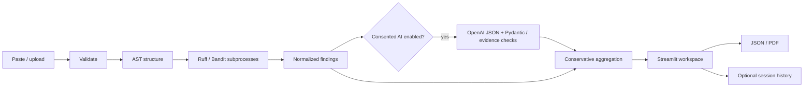

# AI PR Review Copilot

A hybrid Python review assistant for the Cynbit AI/ML Engineer Intern assessment. Independent proof of concept; not an official Cynbit product and not a replacement for human reviewers.

**Existing public demo:** https://cynbit-ai-pr-review-copilot.streamlit.app/

**Repository:** https://github.com/Mahendra-Palsaniya/cynbit-ai-pr-review-copilot

**Improvement branch:** improvement/submission-audit. The baseline live app has been verified; this branch's release awaits approval and live verification.

## Overview and problem

Developers need a clear view of local Python bugs, potentially unsafe patterns and maintainability concerns. Static checks provide reproducible signals; an optional LLM can propose contextual issues, but its claims require verification. This application keeps those sources distinguishable and grounds findings in source evidence.

The original assessment requires exactly an AI Opportunity Report, a functional proof of concept and a Technical Approach Report. The two report documents are in docs/. Evaluation, limitations and test results are part of the Technical Approach Report, with machine-readable evidence in evaluation/.

## Proposed solution and key features

- Paste Python or upload a .py file, with encoding/extension/50 KB validation.
- AST syntax/structure extraction and custom rules, isolated Ruff JSON checks and Bandit security checks.
- Optional contextual OpenAI review with JSON schema and Pydantic/evidence validation.
- Provenance, categories, severity, inclusive lines, evidence, explanations, impact and manual fix guidance.
- Conservative duplicate removal that preserves distinct issues at the same source line.
- Charcoal/violet workspace with navigation, session list, details, information panel and responsive columns.
- Overview, Findings, Code Diff, Security, Code Quality and Suggestions tabs.
- Severity/category filters; optional local baseline diff; real session history when opted in.
- Downloadable JSON and generated PDF reviews. Exports include source evidence.
- No source execution, automatic code edits or automatic merging. Optional selected PR comments require explicit authorization and server-side access controls.

## Screenshots

The supplied dark developer interface is the visual reference. Actual screenshots of the improved running application are captured only after a browser-capable run or approved deployment; no generated mockup is presented as product evidence. See the Technical Approach Report for current visual-verification status.

## Architecture



## Technology stack

Python 3.11; Streamlit 1.56.0; Ruff 0.14.3; Bandit 1.8.6; Pydantic 2.13.4; OpenAI SDK 2.7.1; ReportLab 5.0.1; pytest 8.4.2. All 62 packages in the installed dependency closure are pinned in requirements.lock, included by requirements.txt. The lock is not hash-locked; clean target-platform CI remains necessary. No model training or model checkpoint download is needed.

## Folder structure

```text
app.py                         Streamlit workspace
copilot/
  inputs.py                    Upload/content validation
  models.py                    Review and AI schemas
  review.py                    AST, analyzer adapters, orchestration
  ai.py                        Optional structured contextual reviewer
  context.py                   Key-free contextual AST heuristics
  github_pr.py                 Bounded PR fetching and guarded COMMENT publishing
  aggregation.py               Conservative duplicate removal
  export.py                    Escaped PDF exports
  config.py                    Supported local credentials lookup
scripts/
  fetch_bugsinpy.py             Bounded pinned source acquisition
  prepare_datasets.py          Streaming CodeReviewer / BugsInPy preparation
  evaluate_datasets.py         Reference-separated small evaluations
  inspect_swebench.py           Optional Lite schema inspection
  __init__.py
samples/                       Small illustrative source examples

Evaluation data/results: evaluation/
Tests: tests/
Configuration: .streamlit/config.toml, requirements.txt, .github/workflows/checks.yml
Report documents: docs/AI_Opportunity_Report.md, docs/Technical_Approach_Report.md
```

## Installation and environment setup

Use Python 3.11 and a network connection to install packages. From a terminal:

```powershell
git clone https://github.com/Mahendra-Palsaniya/cynbit-ai-pr-review-copilot.git
cd cynbit-ai-pr-review-copilot
python -m venv .venv
.venv/Scripts/python -m pip install -r requirements.txt
.venv/Scripts/python -m streamlit run app.py
```

On Linux/macOS, substitute `.venv/bin/python` for `.venv/Scripts/python`. Until merged, improvements reside on the named branch. The published main branch may still be the baseline. A restricted Windows environment in this audit stalled at asyncio socket-pair creation; that is recorded as a local standalone-server verification limit, while AppTest runs successfully.

## API key configuration

**No API key is required for normal use.** AST, Ruff, Bandit and narrow contextual AST heuristics work immediately. The heuristic checks are not an LLM and do not offer general language-model reasoning. Leave the AI checkbox off if you cannot configure a key. To enable the optional provider, create `.streamlit/secrets.toml` locally or use Streamlit Community Cloud's Secrets settings:

```toml
OPENAI_API_KEY = "replace-with-your-own-key"
OPENAI_MODEL = "gpt-4.1-mini"
```

This example contains no real credential. Environment variables with the same names are also supported. The CLI evaluator reads environment variables or the local secrets.toml file; the app also supports Streamlit Secrets. Never upload that file, print it in logs or commit it. `.gitignore` excludes it and .env variants. Keys stay server-side; no configured secret is rendered.

The provider/model must be available to your API account and may incur usage charges. Source is sent to OpenAI only when the checkbox is enabled for the review. store=False is requested, but provider retention is governed separately. API timeouts, rate limits, invalid output or missing credentials preserve static results. A public deployment should not expose an unrestricted shared paid key without authentication/quotas and an operational budget.

## How to use

1. Open Code Review, enter a filename and paste complete Python or upload a .py file.
2. Optionally provide the previous version for a local diff. For a real PR, use the separate Pull Requests page.
3. Leave AI disabled for a deterministic review, or explicitly consent to provider processing.
4. Submit and inspect real tool completion status, summary and findings.
5. Filter severity/category and inspect quoted code plus the affected line range.
6. Review suggestions manually. Download JSON or PDF when needed.
7. Enable history in Settings to keep up to ten reviews in session memory. Clear reviews from the sidebar.

Current input and results remain in session memory; historical retention is opt-in. No code database is used. Filenames, authors, branches, reviewers and commit details are never invented. Pull Requests accepts a real public GitHub PR URL and retrieves metadata, diffs and bounded Python source at the changed blob SHA.

## Dataset information and acquisition

Raw data is intentionally kept outside Git. Suggested local directory: `data/` (ignored), or any separate working directory. No supplied dataset code, eval_script, patch or uploaded source is executed by the app.

### BugsInPy: five small pinned examples

Source: https://github.com/soarsmu/BugsInPy. Use Black IDs 1?5, whose buggy commit IDs are pinned in scripts/fetch_bugsinpy.py. The fetch utility retrieves only five metadata/patch/source sets, limits individual responses, and never checks out or executes a project.

```powershell
.venv/Scripts/python -m scripts.fetch_bugsinpy --out data/bugsinpy_raw.json
.venv/Scripts/python -m scripts.prepare_datasets --bugsinpy-raw data/bugsinpy_raw.json --out data/bugsinpy
.venv/Scripts/python -m scripts.evaluate_datasets --kind bugsinpy --data data/bugsinpy --out evaluation/bugsinpy_results.json
```

Preparation extracts the smallest enclosing definition around the first changed buggy line and records original span/hash. This removes module context, so unrelated undefined-name findings are possible. Full historical tests need the benchmark's Python 3.8.3 environments and additional setup; they were not reproduced. Black's inspected source is MIT; the benchmark/corpus license is not assumed from that fact. Raw sources are not redistributed here.

### Microsoft CodeReviewer: supplied Comment Generation archive

Research code: https://github.com/microsoft/CodeBERT/tree/master/CodeReviewer. Dataset: https://zenodo.org/records/6900648. Download only Comment_Generation.zip if needed; do not fetch the other multi-gigabyte archives automatically. The supplied file is approximately 846.6 MB and expands to several gigabytes.

```powershell
.venv/Scripts/python -m scripts.prepare_datasets --codereviewer-zip C:/path/to/Comment_Generation.zip --out data/codereviewer --limit 5
.venv/Scripts/python -m scripts.evaluate_datasets --kind codereviewer --data data/codereviewer --out evaluation/codereviewer_results.json
```

The preparer streams msg-test.jsonl and selects the first five parseable Python post-change sources below the input limit. oldf and patch reconstruct source; msg is written separately as the reference comment. No train data is needed. Inputs/references stay in separate JSONL files. The CodeBERT code is MIT, but a license for the Zenodo corpus was not established; raw corpus redistribution is excluded.

With a securely configured key and authorization to send these inputs, add `--with-ai` and use a separate result filename, such as evaluation/codereviewer_ai_results.json. Never add reference fields to model prompts. The script rejects more than ten inputs in a small run.

### SWE-bench Lite: optional issue-resolution exploration

Sources: https://huggingface.co/datasets/SWE-bench/SWE-bench_Lite and https://github.com/SWE-bench/SWE-bench. The public test parquet is about 2.7 MB; no benchmark images are needed for schema inspection. Download it from the dataset's Files page, then:

```powershell
.venv/Scripts/python -m scripts.inspect_swebench --parquet C:/path/to/test-00000-of-00001.parquet --out data/swebench --summary evaluation/swebench_inspection.json
```

This selects two issue records and separates gold/test patches from issue inputs. The current Windows host blocked the Parquet reader DLL, so no local SWE-bench resolution result is claimed. It is not a direct review-comment benchmark. The harness license and each upstream repository/data license must be considered separately. No data archive is committed.

## Evaluation methodology and actual results

The unit for the authored fixture benchmark is a unique canonical (rule ID, source line_start) finding per file. E722 and BARE_EXCEPT count as one equivalent issue. Labels are not supplied to the reviewer. Exact line matching is required for TP. Precision=TP/(TP+FP); recall=TP/(TP+FN); F1=2PR/(P+R).

Recorded improved static run on 31 October 2026:

| Experiment | Actual measured result |
|---|---|
| 24 synthetic fixtures | TP 23, FP 0, FN 0 |
| Precision / recall / F1 | 1.000 / 1.000 / 1.000 |
| Matched severity agreement | 23/23 authored triage labels |
| Median fixture static latency | 1.406 s on the recorded Windows/Python environment |
| Five BugsInPy definitions | 3/5 changed-line overlaps; 0/5 manually inspected root-cause matches |
| Five CodeReviewer test examples | Static-only mean lexical token F1 0.0451; not semantic correctness |
| Live AI quality, API cost, fix success | Not measured in the current recorded static run |

The synthetic set is tiny, authored with implementation knowledge and has no holdout. Narrow key-free AST contextual rules now cover the authored empty-input division case; this is not general semantic reasoning. The old baseline counted overlapping rules separately, so its headline counts are not directly comparable. BugsInPy full tests were not executed. Word overlap with one human comment does not establish useful review quality. No productivity savings or Cynbit ROI were measured.

See the Technical Approach Report for limitations and raw JSON files in evaluation/. A machine-readable result file is evidence, not an extra report document.

## Testing

```powershell
.venv/Scripts/python -m pytest -q
.venv/Scripts/python -m ruff check app.py copilot tests scripts evaluate.py
.venv/Scripts/python -m bandit -r copilot app.py -q
.venv/Scripts/python evaluate.py
```

Tests cover actual analyzers, invalid/empty/large/encoded uploads, non-execution, tool failures, structured AI success and malformed output, provider errors, aggregation, PDF generation and UI navigation. AppTest uses a bounded 15-second UI startup timeout to accommodate the audit host. GitHub Actions is configured for Python 3.11; fresh remote CI is verified only after publishing changes.

## Deployment

Keep the existing Streamlit Community Cloud deployment. Entrypoint: app.py; branch: main after owner-approved merge; Python: 3.11; dependencies: requirements.txt. Configure any credentials only through Secrets. Main-branch updates can trigger an automatic rebuild; review and approval are therefore required before pushing release changes.

Verify actual startup, paste/upload reviews, tool statuses, filters, session selection, JSON/PDF downloads, AI behavior and narrow-screen layout on the resulting app. Do not call the improved build live merely because a source push succeeded. Baseline deployment evidence in evaluation/hosted-verification.json predates the expanded schema.

## Security and limitations

Source is never executed or imported. Fixed analyzer modules use subprocess argument lists and timeouts. Source and model text are escaped in custom UI/PDF output. No raw provider errors, keys or confidential source are intentionally logged. Submitted suppression comments do not disable assessment checks.

The prototype is not a hardened hostile-input service: AST parsing is in-process; captured output is checked after capture; concurrent users can consume resources; no authentication or global quota is implemented. Confidence and severity mappings are application heuristics. AI evidence validation does not prove a claim. Review all fixes and rerun your own project's tests in an appropriate environment.

## Future scope

Independently annotated evaluations, blinded human comment grading, isolated historical test environments, authenticated and rate-limited deployment, a least-privilege GitHub App, deeper repository context and independently validated changed-line recall. No automatic merge feature is planned without explicit authorization.

## Reports

Exactly two assessment report documents:

- [AI Opportunity Report](docs/AI_Opportunity_Report.md)
- [Technical Approach Report](docs/Technical_Approach_Report.md)

Prior report copies are preserved in Git history and a local working backup; redundant PDFs and the separate deployment document are consolidated into these two Markdown reports.

## References

- Cynbit: https://www.cynbit.in/ ; https://github.com/Cynbit-Technologies ; https://www.linkedin.com/company/cynbit-in/
- Ruff: https://docs.astral.sh/ruff/configuration/
- Bandit: https://bandit.readthedocs.io/en/latest/man/bandit.html
- OpenAI structured outputs: https://developers.openai.com/api/docs/guides/structured-outputs
- Streamlit: https://docs.streamlit.io/deploy/streamlit-community-cloud/deploy-your-app/deploy
- Dataset links and licensing caveats: see the acquisition sections above.

No license grant for this assessment's original code is assumed; choose an appropriate project license before redistribution beyond your intended submission.

## Real GitHub PR review and key-free operation

Open **Pull Requests**, paste `https://github.com/OWNER/REPOSITORY/pull/NUMBER`, and submit. Public PR reading requires no token. The client validates the exact GitHub host, refuses redirects, fetches immutable blobs, limits each file to 50 KB, and reviews at most 10 Python files / 150 KB from the first 100 changed files. Skips and truncation are explicit. Findings are restricted to added lines where a patch is available; missing patches are labeled as full-file review. A changed head is rejected. Complete file content is analyzed without execution.

The default key-free path adds evidence-backed AST heuristics for constant zero denominators, unguarded single-return division by input length, and attribute access on a None-default argument. External caller contracts may make these safe; verify the suggestion. This is an alternative for users unable to configure an API key, not a claim of LLM functionality.

Optional private PR access uses a server-side `GITHUB_TOKEN` with read-only repository contents and PR access. Publishing additionally needs PR-write permission, a separately configured `GITHUB_PUBLISH_CODE`, selected mapped findings, an access-code challenge, an explicit authorization checkbox, and a fresh unchanged-head check. The application posts COMMENT reviews only; no approval, request-changes, merge or source edit is performed. Configure these values in Streamlit Secrets or environment variables, never in source or chat. Leave them unset for safe public read-only use. Do not grant a shared public app unrestricted repository write access.

GitHub reads use a 12-second timeout, a 2 MB response limit and 30 requests/minute per application process. UI cooldowns are 15 seconds for PR fetches and 2 seconds for local reviews. These are prototype controls, not distributed abuse protection.

## Recorded release verification

The prior release `31520381172776403305687e37ea7f0754548c21` was verified live on Streamlit Community Cloud; its GitHub Actions run succeeded. This new PR/key-free release has **82 passed, 0 failed, 0 skipped** local tests (61.597 seconds), with mocked GitHub network/publishing tests and actual AST/Ruff/Bandit execution. Live PR networking and clean installation of the new lock must still be checked after approved publication. No live OpenAI call or real comment publication is claimed.

Actual narrow-viewport screenshots of the running prior release:


