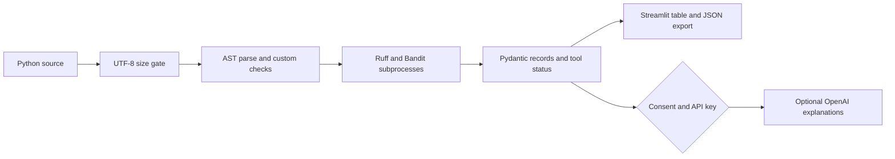

# Technical Approach Report
## Cynbit AI PR Review Copilot

31 October 2026 | Implemented assessment prototype

### Scope and architecture

The implementation accepts one complete Python source file and returns structured review findings. It does not parse PR diffs, retrieve GitHub code, execute uploaded code, or train an ML model.

AST returns syntax feedback, mutable literal defaults and bare-except findings. Ruff selects E4/E7/E9/F with isolated configuration and no cache. Bandit scans the temporary source with submitted `nosec` suppression ignored. JSON outputs map to Pydantic finding fields: tool, rule, positive line, low/medium/high severity, message and remediation suggestion. Ruff severity is mapped to low; Bandit severity is preserved. Findings are sorted, not semantically deduplicated: different tools can report related problems. Suggestions are generic manual guidance, not verified patches.

### Execution and trust boundaries

The 50 KB UTF-8 gate precedes parsing. A fixed Python interpreter launches fixed analyzer modules using subprocess argument lists and a 15-second timeout per analyzer; no shell is used. A random temporary directory contains a fixed submitted.py filename and is cleaned on normal exit. Submitted content is never imported or run. Syntax failure returns immediately without claiming analyzer completion. Tool failures preserve AST findings and visibly mark incomplete results.

The process is not a hardened hostile-code sandbox. AST parsing occurs in-process without a hard memory or CPU quota. Abrupt termination may leave temporary files. Concurrent users can multiply resource use. For production, isolate parsing and analyzers in workers with resource quotas, bound the queue, authenticate users, rate-limit requests and define retention policies. There is no database or code logging in the application, but UI session memory and hosting/provider telemetry still exist.

### LLM approach and fallback

The optional OpenAI Responses adapter explains supplied findings using a configurable model (default gpt-4.1-mini). It receives source and structured results only after checkbox consent. The API key stays in server environment settings; it is never rendered. The request has a timeout, no automatic retry, output-token limit and store=False. Provider retention is governed separately. Model output is plain unverified commentary displayed separately from deterministic records and never used to execute code or post comments. Model output is not validated as a finding list. No key, no consent, provider errors and empty responses produce clear fallback messages while static review survives.

A live LLM request was not made. Mocked failure tests establish fallback behavior, not model quality or production API availability. Future model evaluation should blind reviewers to provider identity, label unsupported claims and compare explanations against a deterministic-only baseline.

### Dataset and measurement

Twelve authored examples in evaluation/cases.json cover two clean files, unused imports, undefined names, positional/keyword mutable defaults, bare except, eval, assert, syntax failure, ignored nosec suppression and an empty-input semantic defect. No third-party code, training set, holdout set or private company dataset was used. Labels are exact expected rule/line pairs chosen before running this evaluation. The empty-input case uses an unsupported semantic label to record a known false negative rather than claiming universal detection.

The evaluator computes unique (rule, line) set intersections/differences per case, counts all returned rules, records per-case latency with perf_counter and writes environment/tool versions. Rule-level overlap is counted separately; these metrics cannot be interpreted as unique real-world bug accuracy. The fixture set is tiny, implementation-aware and not independently labeled.

Measured: TP=11, FP=0, FN=1; precision=1.000, recall=0.917; median latency=1.13 seconds. One semantic false negative remains. Raw per-case records are in evaluation/results.json. No costs, live API latency, concurrency, real PR accuracy or human productivity gains were measured.

### Verification and reproducibility

Seventeen pytest tests passed, including real-tool integration, source non-execution, invalid/oversized input, analyzer failure/timeout behavior, no-key/no-consent paths, redacted provider failures and Streamlit AppTest interaction. Ruff lint and Bandit application scans passed. Subprocess-related Bandit B404/B603 suppressions are scoped to the fixed analyzer invocation and documented here; their presence is not evidence of zero security risk. Direct dependencies are pinned in requirements.txt; transitive packages are not locked. GitHub Actions is configured to run lint, security checks, tests and evaluation on Python 3.11. The initial GitHub Actions run 41174769485 passed independently on Linux after publication.

### Deployment and next work

The owner selected Streamlit Community Cloud using the public GitHub repository, main branch, app.py entrypoint and Python 3.11. Initial deployment leaves the optional API key unset. Public hosting is live at https://cynbit-ai-pr-review-copilot.streamlit.app/ (verified 31 October 2026). A hosted sample completed all three analyzers, its JSON export contained the expected three rule IDs, and the no-key fallback preserved the results. Render deployment was canceled at the owner's request. Before production use add authentication, quotas, operational monitoring, controlled upgrades, independent benchmark labeling and a secure GitHub App flow. PR support requires base/head source retrieval, changed-line mapping, repository trust rules and human-approved publishing; these are future features.

### References

- Ruff configuration: https://docs.astral.sh/ruff/configuration/
- Bandit CLI: https://bandit.readthedocs.io/en/latest/man/bandit.html
- OpenAI Python SDK: https://github.com/openai/openai-python
- Cynbit public context: https://www.cynbit.in/
