# Technical Approach Report
## AI PR Review Copilot

**Prepared by:** Mahendra Palsaniya

**Assessment:** Cynbit AI/ML Engineer Intern

**Date:** 31 October 2026

**Build status:** PR/key-free improvements are published and verified live. 83 local tests pass. Optional live LLM verification remains unavailable without credentials; default operation needs no key.

## 1. Project overview

AI PR Review Copilot is a Python review-assistance application with a Streamlit interface. The original safe static-analysis path was inspected and retained, then expanded with richer finding records, input validation, contextual AI output validation, conservative aggregation, exports, navigation and browser-session history. It assists human reviewers and does not autonomously approve, modify or merge code.

The existing public repository is https://github.com/Mahendra-Palsaniya/cynbit-ai-pr-review-copilot and the baseline deployment is https://cynbit-ai-pr-review-copilot.streamlit.app/. The improvement branch is `improvement/submission-audit`. The improved PR/key-free build was verified live during this audit, including a real public PR read and JSON/PDF downloads.

## 2. Problem definition

A developer needs to inspect potential Python bugs, unsafe patterns and maintainability concerns without running submitted code on the review server. Lint tools provide deterministic rule matches but not complete behavioral reasoning. Generated review text can add context while also introducing unsupported claims. The system therefore preserves provenance and uncertainty rather than combining every signal into an undifferentiated verdict.

## 3. Objectives and scope

Implemented scope: local paste/upload up to 50,000 UTF-8 bytes, or up to ten changed Python PR files / 150 KB total; AST structure; Ruff and Bandit; optional structured OpenAI review; line evidence and suggestions; conservative deduplication; local diff; session history; JSON/PDF review exports; reproducible tests and small dataset scripts. The UI includes all requested navigation destinations, with security and quality views exposing real analyzed findings.

Excluded scope: automatically applied patches, repository-wide inference, multi-language review, model training and execution of uploaded source. Real GitHub metadata is displayed only when returned by the API. Local baseline input supports a separate user-supplied diff.

## 4. System architecture

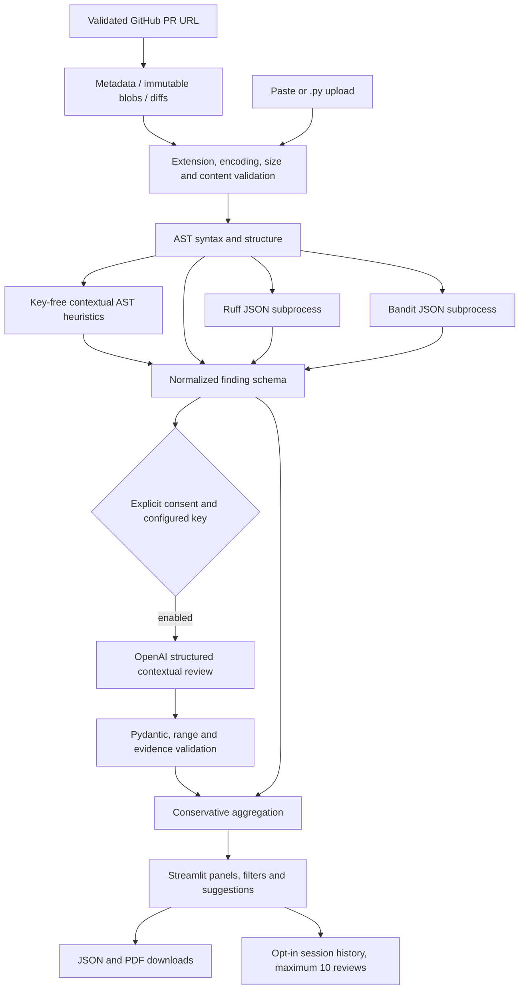

The application server launches fixed analyzer modules through the current Python interpreter. Submitted source is written to a random temporary directory under a fixed filename, then removed on normal completion. No command shell receives source content. The external provider is a separate trust boundary, entered only after source-sharing consent.

## 5. Technology stack

| Component | Delivered version / use |
|---|---|
| Python | 3.11.9 used in recorded tests; document Python 3.11 setup |
| Streamlit | 1.56.0; navigation, forms, session state, tabs and downloads |
| Ruff | 0.14.3; E4/E7/E9/F rules, isolated configuration |
| Bandit | 1.8.6; Python security rule matches |
| Pydantic | 2.13.4; structured review and AI schemas |
| OpenAI Python SDK | 2.7.1; optional Responses API adapter |
| ReportLab | 5.0.1; escaped, user-requested PDF review exports |
| pytest | 8.4.2; automated behavior and UI testing |

Direct dependencies are pinned in requirements.txt. Transitive dependencies are not locked; a clean-install CI run remains an important compatibility check. The two assessment reports use Markdown; generated per-review PDFs are application exports rather than additional assessment report documents.

## 6. Application workflow

The sidebar selects Dashboard, Code Review, Pull Requests, Review History, Security Analysis, Code Quality, Evaluation, Settings or About Project. A new review accepts code, an optional .py upload and an optional baseline. Progress reflects validation, parsing, each analyzer and optional AI. The list shows actual session IDs, filenames, UTC timestamps and finding counts.

Results remain in session state while filters or download controls rerun the script. Overview distinguishes static and AI summaries. Findings expose source evidence and filters. Security describes potential weaknesses, Code Quality shows quality/maintainability/bug/performance findings, and Suggestions presents manual recommendations. The information panel records actual completion status rather than equating completion with a clean result. No arbitrary code-quality score is used.

## 7. Data pipeline

`copilot/inputs.py` validates the input before analysis. Uploaded filenames are reduced to a sanitized basename and must end in .py. Raw upload size and normalized UTF-8 source size are both limited. Python encoding declarations and UTF-8 BOMs are supported; invalid encoding, empty input, invalid Unicode and null bytes are rejected.

`review_code` produces a `Review` with normalized findings, extracted structure, tool statuses and latency. Only source and a safe allowlist of review context enter the AI request. `scripts/prepare_datasets.py` writes separate inputs.jsonl and references.jsonl files outside Git. Dataset reference files are loaded after review generation in the evaluator.

## 8. Python AST processing

Python's ast module parses source without executing it. The implementation extracts imports, function names, argument names, classes and start/end lines. Literal list/dict/set defaults receive an AST finding because they persist across calls. Bare except handlers receive a maintainability finding. Syntax errors produce a line-localized syntax finding and mark the remaining analyzers as not run.

These custom checks are intentionally limited. They do not perform general dataflow, interprocedural analysis or exhaustive logical-bug detection. Parsing runs in-process; file limits do not constitute a hard CPU/memory sandbox. Production deployment needs worker isolation and resource quotas.

## 9. Ruff static analysis

The adapter uses a subprocess argument list, not a concatenated command. Flags select JSON output, isolated configuration, no cache and E4/E7/E9/F checks. Submitted noqa comments are ignored for consistent assessment scanning. Each result retains rule ID, message, normalized filename, line range and column.

Ruff has no unified severity taxonomy matching this application. F821 is mapped to high as a project triage decision; other selected Ruff findings map to low. This mapping is documented and not called an industry-standard metric. Suggestions are manual guidance and do not assert that a code change has been tested.

## 10. Bandit security analysis

Bandit runs against the temporary Python file with JSON output and ignore-nosec enabled. Records preserve test ID, issue text, line, source evidence and severity. Bandit HIGH/MEDIUM/LOW confidence is mapped to 0.95/0.70/0.40 for display. These numbers are heuristic labels, not calibrated probabilities.

Bandit detection establishes that a pattern matched, not that a deployed system is exploitable. Analyzer timeout, malformed output, error return or parse errors mark that tool incomplete while retaining other completed findings. Each subprocess has a 15-second timeout. Output is bounded after capture; a production worker should also enforce hard process/output limits.

## 11. LLM model selection and integration

The existing OpenAI provider is retained. The configurable default is gpt-4.1-mini, chosen as a practical structured-output API option for the prototype rather than a claim that it is the best current model. Model availability depends on the user's account. No foundation model is trained or downloaded.

The adapter requests JSON-schema output through the Responses API, with a 30-second timeout, no automatic retries, a 5,000-output-token cap and store=False. A configured local environment key or explicitly configured secret is used without displaying its value. A missing key or consent preserves the deterministic path. Provider refusals, incomplete responses, rate limits, malformed JSON and validation failures become generic statuses without raw exception text or source logging.

Live provider compatibility, model quality, latency and usage must be recorded only after actual authorized calls. Mocked success/failure tests prove adapter behavior, not live API access. No live AI measurement is claimed in the current recorded static dataset results.

## 12. Prompt engineering

The system prompt declares source comments and strings to be untrusted data. It requests plausible logical defects, edge cases, error-handling, maintainability/performance issues and useful tests; asks for actionable evidence with inclusive source lines; discourages repeating static findings; and prohibits code execution or automatic edits. The request gives the model no tools.

The input builder allowlists filename, numbered source, static findings and extracted structure. It never accepts a reference comment, gold target or dataset patch as a separate arbitrary model context. For CodeReviewer, oldf and patch reconstruct the submitted post-change file; msg remains ground truth. Prompt boundaries reduce injection risk but do not prove immunity to adversarial content.

## 13. Pydantic output validation

Every AI finding requires id, title, category, severity, line_start, line_end, evidence, explanation, impact, suggested_fix, confidence and source. Source must be AI. Extra properties are forbidden; severity/category values are constrained; confidence is within [0,1]; lines are positive and ordered.

Validation additionally limits the number of findings and text size, rejects lines beyond the source, and requires non-empty quoted evidence to occur inside the cited lines. A valid schema and real source quote do not validate the semantic claim. Accepted findings remain labeled as potential AI findings, and suggested fixes always require human verification.

## 14. Finding aggregation

`copilot/aggregation.py` groups findings conservatively by file, location, source class and rule family. AST BARE_EXCEPT and Ruff E722 are the only explicit cross-tool equivalence family. Sources and related rule IDs are preserved, and the higher triage severity survives. Bandit B110 remains separate because swallowing an exception is distinct from catching all exception types.

Column positions preserve separate undefined names on one line. AI hypotheses remain separate from static findings and are deduplicated only conservatively by their location/title identity. No embedding-based semantic deduplication is claimed. Display ordering uses severity, line and provenance.

## 15. Dataset selection and preparation

### BugsInPy

Five Black bugs, IDs 1?5, were selected in order. Bug metadata and patches come from BugsInPy; buggy black.py revisions are fetched by the published commit IDs. Full source files exceed the app's file limit, so the pipeline extracts the smallest enclosing definition containing the first removed patch line, including decorators, and dedents it. Original span and SHA-256 are recorded. The benchmark references Python 3.8.3; its full historical environments and regression tests were not installed here.

Black's upstream source at the inspected revision carries an MIT license. The BugsInPy root did not establish a separate blanket corpus license during inspection. Only preparation scripts, IDs, hashes and aggregate results are committed, not the raw third-party sources or patch archive. Definition extraction loses module context and can introduce unrelated undefined-name warnings.

### Microsoft CodeReviewer

The user supplied Comment_Generation.zip (846,602,315 bytes). Its members are msg-train.jsonl, msg-valid.jsonl and msg-test.jsonl; the compressed archive expands to several gigabytes. Preparation streams only the test member, examines 28 records, and selects the first five parseable Python post-change files below 50 KB. No full extraction is performed.

Observed fields include oldf, patch, msg, id, y, idx, proj and lang. oldf plus patch reconstruct the model input; msg is written to a separate reference file. The CodeBERT repository is MIT licensed, but the Zenodo archive's dataset license was not established from the available metadata. Raw corpus redistribution is therefore excluded from this submission; no claim is made that the repository license automatically covers all collected review data.

### SWE-bench Lite

SWE-bench Lite is an issue-resolution benchmark, not a review-comment benchmark. The public test parquet is approximately 2.7 MB; its viewer exposes issue IDs, repositories, base commits, problem statements, patches, test patches and execution metadata. The file was downloaded for a two-row inspection, but local Parquet loading was blocked by Windows Application Control. That control was not bypassed. No benchmark environment, image, eval_script or patch was executed, and no SWE-bench resolution result is claimed.

The SWE-bench harness repository is MIT licensed. Underlying repository and issue/code rights require separate inspection; a harness license does not establish universal rights to all data. Raw inputs and references stay outside Git.

## 16. Evaluation methodology

Synthetic evaluation uses unique canonical (rule ID, line_start) findings per file. E722 maps to BARE_EXCEPT to match the aggregation policy. Expected labels are not supplied to the reviewer. Precision=TP/(TP+FP), recall=TP/(TP+FN), F1=2PR/(P+R). A true positive requires the expected exact line. Severity accuracy is measured only on matched findings against authored triage labels; it is not a public severity benchmark.

BugsInPy evaluation counts whether any finding overlaps an edited buggy line in the extracted definition. Manual inspection found 0/5 root-cause matches: all warnings were F821 signals caused by missing module context. The overlap measure cannot be interpreted as known-bug recall: a warning about a missing import may overlap a patch by coincidence. Full precision/recall cannot be computed without independently annotating all findings and bugs.

CodeReviewer evaluation compares generated finding explanations/fixes with the single human comment using multiset word-token overlap F1. This is a lexical baseline, not a semantic correctness score. Human usefulness/correctness grading is not yet performed. No reference comment or gold target is sent to the model. Static-only and hybrid runs must be recorded separately.

No untrusted fixes or dataset scripts are executed. Fix success rate remains unmeasured. API latency, tokens and cost remain unmeasured until actual provider use; cost is not guessed from unverified pricing.

## 17. Actual experimental and testing results

Recorded improved static run on Windows/Python 3.11.9:

| Experiment | Actual result | Interpretation |
|---|---|---|
| 24 synthetic fixtures | TP=23, FP=0, FN=0 | Canonical rule/line findings after duplicate merging |
| Fixture precision / recall / F1 | 1.000 / 1.000 / 1.000 | Small authored set, no holdout or independent labels |
| Severity on matched fixture findings | 23/23 | Agreement with authored triage labels only |
| Median fixture review latency | 1.406 seconds | Local static pipeline; varies by environment |
| Five BugsInPy definitions | 3/5 patched-line overlaps; 0/5 root-cause matches on manual inspection | All warnings were context-related F821 signals |
| BugsInPy median static latency | 1.423 seconds | Extracted-definition review only |
| Five CodeReviewer test examples | Mean token F1=0.0451 | Static-only lexical baseline, not LLM quality |
| CodeReviewer median static latency | 1.385 seconds | Excludes any LLM API call |
| Automated tests | 83 passed in the final local full-suite run | Final local full-suite run; 0 failures |
| Live model quality / API cost / fix success | Not measured | Access and execution dependencies must not be fabricated |

The additional narrow AST contextual rule covers the former empty-input division false negative. This is an implementation-aware fixture improvement, not independent evidence of generalization. The earlier baseline counted duplicate rule IDs separately and reported TP=11/FN=1; it is not directly comparable with the canonicalized count. Raw current records live under evaluation/, including results.json, bugsinpy_results.json and codereviewer_results.json. The old hosted verification files describe the baseline schema; fresh deployment verification must identify the new build explicitly.

Commands exercised include `python -m pytest -q`, `python -m ruff check app.py copilot tests scripts evaluate.py`, `python -m bandit -r copilot app.py -q`, `python evaluate.py`, and `python -m scripts.evaluate_datasets` for both prepared datasets. Provider failures and malformed output are tested with mocks. The complete local test suite was rerun after the PDF filename fix: 83 passed, zero failures/skips.

## 18. Application screenshots and visual verification

The user-provided reference guided the charcoal/purple palette, compact panels, review list and information layout. It is a visual reference, not a screenshot of this implementation. Actual desktop (1280 x 720) and narrow (615 x 524) screenshots of the working application are included below. The PR/key-free release was verified live. No fabricated interface images are included. AppTest has exercised dashboard rendering and navigation; this does not substitute for visual review at desktop and narrow widths.

## 19. Deployment architecture

The application is hosted on Streamlit Community Cloud, serving app.py from the public GitHub repository's main branch with Python 3.11 and requirements.txt. No Render migration is planned. The owner approved publication; main and the improvement branch contain the released PR/key-free implementation.

Local standalone startup stalled while creating the Windows asyncio socket pair, before listening. A diagnostic stack located that wait; basic socket bind succeeded and AppTest passed. This is recorded as an environment-specific local-browser verification limitation, not hidden as a successful startup. After authorized publication, inspect clean dependency installation, actual UI rendering, static tool statuses, uploads, filters, exports and no-key behavior on the live app. Revert to the previous verified commit if a release fails.

## 20. Security and privacy

Uploaded code is never executed, imported, automatically patched or merged. Filenames, encodings and sizes are validated; analyzer commands use fixed modules and argument lists; output and time limits are applied. Application output escapes user-controlled HTML/XML in custom cards and PDFs. Source snippets use st.code; AI prose uses st.text. Raw provider exceptions are not exposed or logged.

External LLM processing requires explicit consent. store=False is requested but does not guarantee zero provider retention. Keys are read from environment/secret settings and are excluded from Git. The current source and results necessarily occupy session memory; history retention is opt-in, bounded to ten reviews and clearable. Exported reports contain source evidence and should be handled as potentially sensitive. No code database or disk-backed review history is created.

Production hardening still requires authentication, request/concurrency quotas, a source-retention policy, process resource isolation, monitoring and a bounded operational budget before exposing a shared paid provider key broadly. Prompt instructions, file limits and tests are not a claim of complete security.

## 21. Limitations

This is an assessment prototype. Local review accepts one file; PR review accepts up to ten changed Python files and 150 KB total. It does not understand complete repository behavior, cannot prove security or correctness, and retains false-negative risk. AI evidence checking does not validate reasoning. Suggestions are manual; no fix success is claimed. Datasets are tiny selections with possible model-training contamination and selection bias. BugsInPy extraction loses context; CodeReviewer has only one reference comment per selected item. SWE-bench execution was not performed. The 62-package dependency closure is pinned, but wheel hashes and cross-platform resolution are not guaranteed.

## 22. Future enhancements

Priorities are independently labeled findings, blinded human comment grading, isolated historical regression environments, a least-privilege GitHub App, deeper multi-file repository context, source retention/access controls and usage quotas. Model comparisons should use the same input set with separate references and record provider model/version, prompts, latency, tokens and verified pricing. Automatic patch application and PR merging remain out of scope unless explicitly authorized in a future project.

## 23. Execution plan

| Stage | Work | Exit evidence |
|---|---|---|
| Audit | Inspect tracked files/history, original assessment, references and deployment | Baseline tests and explicit gap list |
| Engine | Rich schema, validation, provenance and aggregation | Unit/integration tests and analyzer scans |
| Interface | Dark panels, real session data, filters and exports | AppTest and actual visual/browser verification |
| Data | Small bounded selections, input/reference isolation | Provenance, preparation and raw metric JSON |
| AI | Configured provider and independent input generation | Authorized live responses; no-key/error tests |
| Documentation | Two canonical Markdown reports and README | Consistency checks against final implementation |
| Release | Owner-approved push and existing-platform update | CI, live behavior checks and actual screenshots |

Implemented local stages are documented above. Pending external-access and release checks are not marked complete until verified. No assessment submission, email or application form is sent automatically.

## 24. Conclusion

The improved prototype makes review evidence and uncertainty explicit while preserving the original safe deterministic workflow. Its tests and small static dataset results are reproducible within their documented scope. The deployed proof of concept and two reports are available for submission. Optional LLM behavior has mock-based coverage but requires credentials for a live provider test; the key-free demonstration is fully usable.

## 25. References

- Cynbit public website: https://www.cynbit.in/
- Cynbit organization: https://github.com/Cynbit-Technologies
- Cynbit LinkedIn: https://www.linkedin.com/company/cynbit-in/
- Ruff: https://docs.astral.sh/ruff/configuration/
- Bandit: https://bandit.readthedocs.io/en/latest/man/bandit.html
- OpenAI structured outputs: https://developers.openai.com/api/docs/guides/structured-outputs
- Pydantic: https://docs.pydantic.dev/latest/
- Streamlit session state: https://docs.streamlit.io/develop/api-reference/caching-and-state/st.session_state
- Streamlit deployment: https://docs.streamlit.io/deploy/streamlit-community-cloud/deploy-your-app/deploy
- BugsInPy metadata: https://github.com/soarsmu/BugsInPy
- Black source license at the inspected revision: https://github.com/psf/black/blob/26c9465a22c732ab1e17b0dec578fa3432e9b558/LICENSE
- Microsoft CodeReviewer: https://github.com/microsoft/CodeBERT/tree/master/CodeReviewer
- CodeBERT source license: https://github.com/microsoft/CodeBERT/blob/master/LICENSE
- Dataset archives: https://zenodo.org/records/6900648
- SWE-bench Lite: https://huggingface.co/datasets/SWE-bench/SWE-bench_Lite
- SWE-bench harness: https://github.com/SWE-bench/SWE-bench

## Release addendum: PR integration, key-free alternative and reproducibility

`copilot/github_pr.py` implements validated public PR reads through GitHub REST, immutable blob retrieval, real metadata and changed-line mapping. It refuses redirects and arbitrary hosts; each request has a 12-second timeout and 2 MB response limit. Scanning is bounded to 10 changed Python files, 50 KB each and 150 KB total, from the first 100 changed files. Omitted/deleted/oversized/unavailable files and truncated lists are displayed. It rechecks the PR head. Findings include actual file paths and line numbers. Missing diff data is explicitly labeled as full-file analysis.

Optional publishing accepts only selected findings mapped to added RIGHT-side lines, requires authorization, a server token, a separate server publish access code and a matching unchanged head. It posts a COMMENT event, never merges or modifies source. Automated tests mock all writes; no actual comment was posted. The shared process limits GitHub requests to 30/minute; Streamlit applies 15-second PR and 2-second local-review cooldowns. Distributed quotas and authenticated team ownership are future production work.

`copilot/context.py` provides an immediate no-key alternative: conservative AST rules identify constant zero division, single-return unguarded division by input length and attribute access on None-default arguments. These are explicitly heuristic potential findings with evidence and human-verification guidance. They are not an LLM, interprocedural analysis or general reasoning. The optional OpenAI adapter remains available; live model quality and API operation are unverified without credentials. Users do not need to configure a key to use the application.

`requirements.lock` pins the 62-package installed dependency closure for Python 3.11, generated by `scripts/lock_dependencies.py` and consumed by requirements.txt. Installed metadata constraints were checked; hashes are not locked. CI additionally runs pip check. A clean target-platform install must pass before the release is described as reproducible on that target.

The final local test record is evaluation/tests.xml: 83 tests, zero failures/errors/skips, 74.06 seconds. Coverage includes invalid URLs, unavailable/malformed APIs, missing blobs, unchanged-line filtering, limits, stale-head write rejection, unauthorized publishing, malformed metadata, key-free findings, all navigation pages and JSON/PDF generation. GitHub transport is mocked in these tests. Actual local analyzers are invoked. Synthetic evaluation now includes 24 authored cases with 23 positive canonical findings: TP23/FP0/FN0, precision/recall/F1 1.000; matched severity 23/23; median 1.406 seconds. Cases include security patterns, suppression comments, negative guards and contextual errors. This implementation-aware set is too small and biased for a real-world accuracy claim. BugsInPy remains 0/5 manually confirmed root-cause detections; the 3/5 line overlap is not bug recall. CodeReviewer remains a static lexical baseline (0.0451), not an LLM quality measurement.

Actual prior-release narrow-viewport screenshots, captured from the live application:

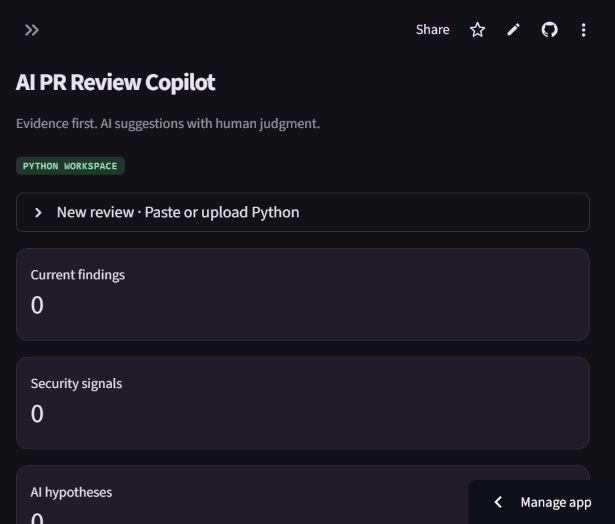

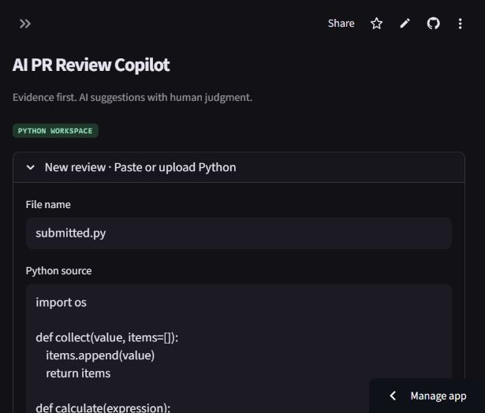

The prior release 31520381172776403305687e37ea7f0754548c21 was tested live and passed GitHub Actions. The PR/key-free release was approved, published and verified live. Local standalone HTTP startup remains blocked at the host's asyncio socket-pair initialization; AppTest passes. Desktop and narrow layouts were inspected. No live OpenAI result, real PR write or SWE-bench resolution is claimed.

Additional API references: https://docs.github.com/en/rest/pulls/pulls#list-pull-requests-files ; https://docs.github.com/en/rest/git/blobs#get-a-blob ; https://docs.github.com/en/rest/pulls/reviews#create-a-review-for-a-pull-request .

## Final requirement audit and live verification

The owner approved this release. The functional build `2ecf49b4f0d736b603ab6aa9af6e4a1f99a7620e` passed a clean Linux build ([CI run](https://github.com/Mahendra-Palsaniya/cynbit-ai-pr-review-copilot/actions/runs/41193779051)) and was exercised on the existing public Streamlit app. The subsequent PDF change adds each finding's filename and has a dedicated regression test. No API key is needed for the demonstrated default mode.

The live PR read used psf/black#5638, head 3fd5966c0c63d86965f03dd132fbde7263284ed0. One Python test fixture was analyzed, CHANGES.md was excluded as non-Python, and src/black/linegen.py was skipped because it exceeded 50 KB. Eight F821 warnings were mapped to added lines. They are name warnings in formatting test data, not eight demonstrated defects. The live JSON download validated against the Review schema; the PDF downloaded, rendered and was visually inspected. Poppler emitted two missing-display-font warnings; its inspected first page remained readable. A separate pasted demo produced four findings including the key-free empty-input check, a mutable default and Bandit signals. No source was executed.

| Requirement | Location | Verification | Status |
|---|---|---|---|
| Cynbit public research and industry opportunities | AI_Opportunity_Report.md | Linked public sources, assumptions separated | COMPLETE |
| Opportunity comparison and proposed business value | AI_Opportunity_Report.md sections 6-14 | No internal metrics or ROI invented | COMPLETE |
| Functional proof of concept | app.py, copilot/ | AppTest, live paste and public PR run | COMPLETE |
| AST, Ruff, Bandit and structural extraction | review.py, context.py | Actual analyzer tests and live statuses | COMPLETE |
| Optional LLM contextual integration | ai.py, models.py | Structured output/error/evidence tests; no live credential | PARTIAL |
| Input validation and non-execution | inputs.py, review.py | Invalid/empty/large/encoding and non-execution tests | COMPLETE |
| Pydantic validation and conservative deduplication | models.py, aggregation.py | Malformed AI/evidence/column/duplicate tests | COMPLETE |
| Public GitHub PR metadata, source and diffs | github_pr.py, app.py | Live psf/black#5638 read; mocked edge cases | COMPLETE |
| Optional authorized comment publishing | github_pr.py, app.py | Mock COMMENT payload and unauthorized/stale-head tests; real write not attempted | PARTIAL |
| Severity/category filters and evidence/fixes | app.py | AppTest plus live Findings/Security/Quality/Suggestions views | COMPLETE |
| JSON/PDF exports | models.py, export.py | Unit tests, live downloads, rendered PDF inspection | COMPLETE |
| Dark responsive dashboard and real session data | app.py, .streamlit/config.toml | Actual 1280x720 and 615x524 observations | COMPLETE |
| Opt-in bounded session history | app.py | State/rerun/history tests; no disk code database | COMPLETE |
| Secret handling, timeouts, URL validation, rate limits | config.py, inputs.py, github_pr.py, ai.py | Security scan and unit tests; production isolation remains out of scope | COMPLETE within prototype scope |
| Synthetic evaluation and precision/recall/F1 | evaluate.py, evaluation/ | 24 authored cases, exact canonical finding/line unit | COMPLETE |
| BugsInPy and CodeReviewer small selections | scripts/, evaluation/ | Five cases each; references separated; honest negative/lexical results | COMPLETE for bounded baseline |
| SWE-bench Lite issue-resolution exploration | inspect_swebench.py | Public schema inspection; local DLL blocked, no patch execution | PARTIAL |
| Reproducible pinned environment | requirements.lock, requirements.txt, .python-version | 62 pinned packages; clean Linux CI and pip check | COMPLETE, without wheel hashes |
| Automated tests/lint/security CI | tests/, checks.yml | 83 local tests pass; clean branch CI passes | COMPLETE |
| Two assessment reports and README | docs/, README.md | Exactly two report Markdown documents; no duplicate evaluation report | COMPLETE |
| Existing public deployment | app.py / Streamlit Community Cloud | Actual live reviews and downloads | COMPLETE |

Production authentication, distributed quotas, hard worker isolation, independently labeled semantic evaluation, historical BugsInPy regression execution and live LLM assessment remain future work. No assessment form or email has been submitted automatically.

### Actual application screenshots

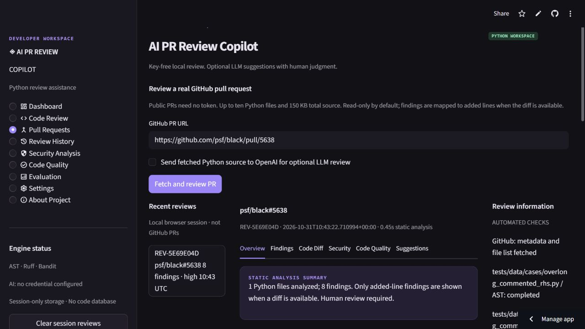

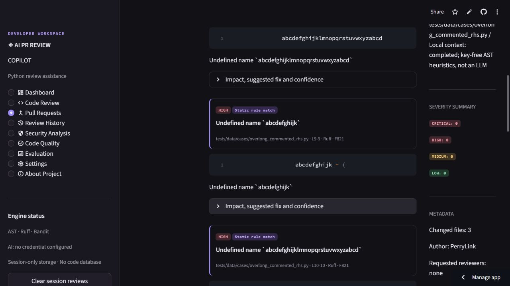

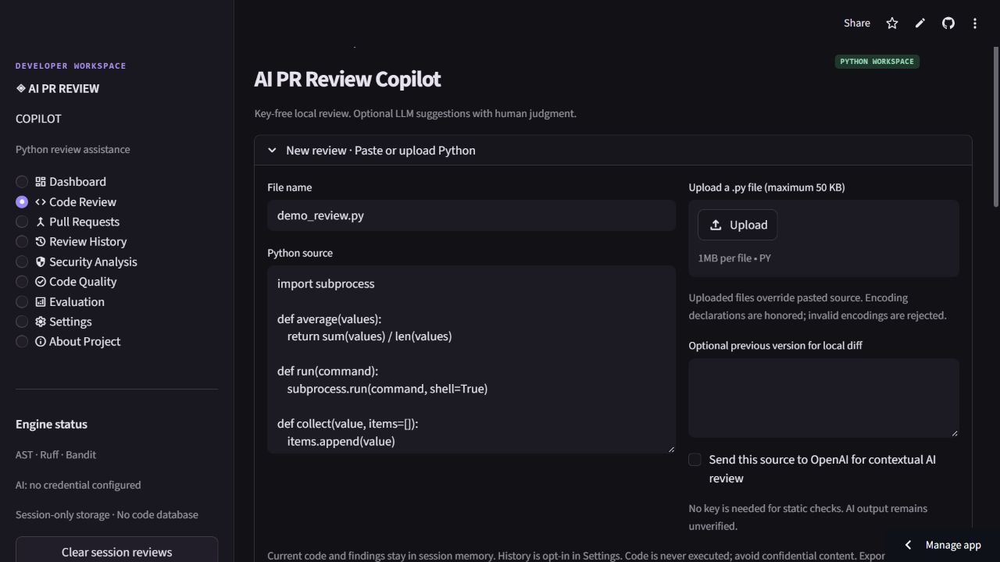

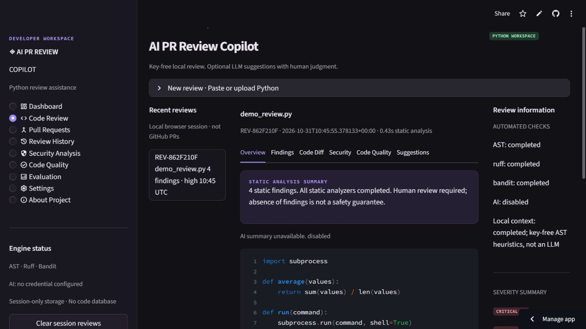

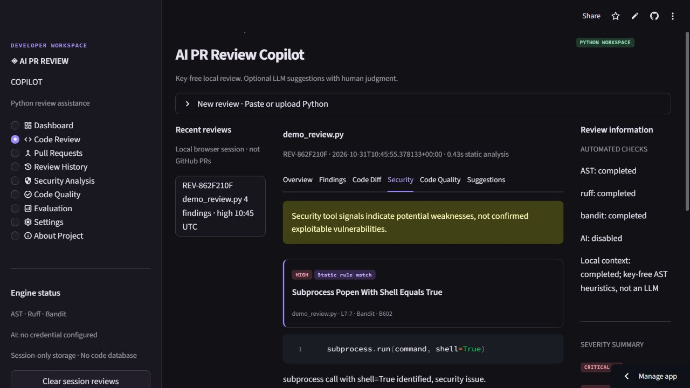

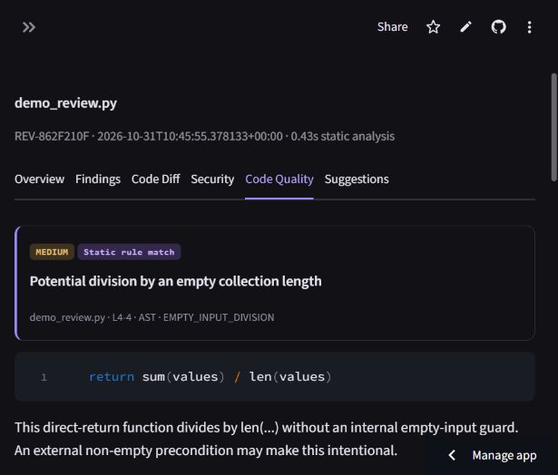

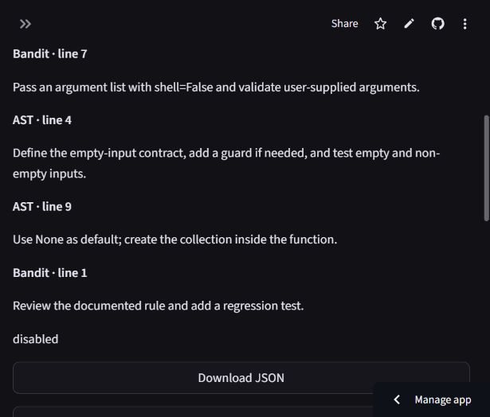

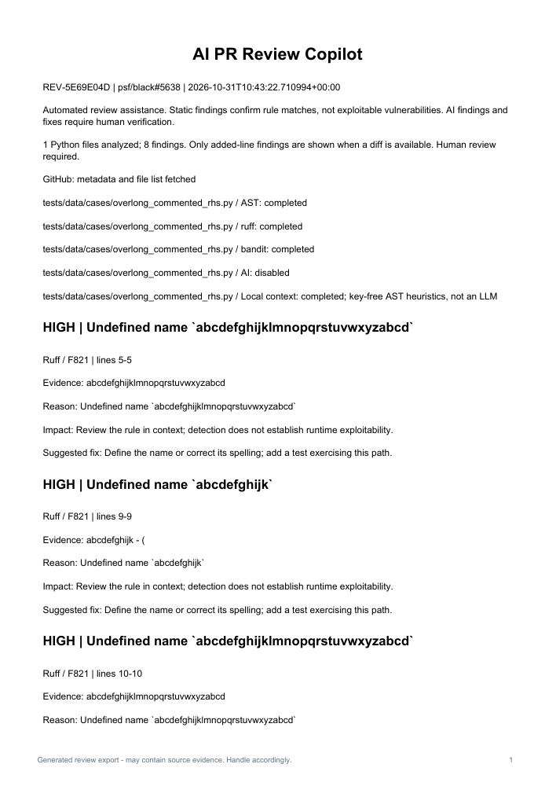
